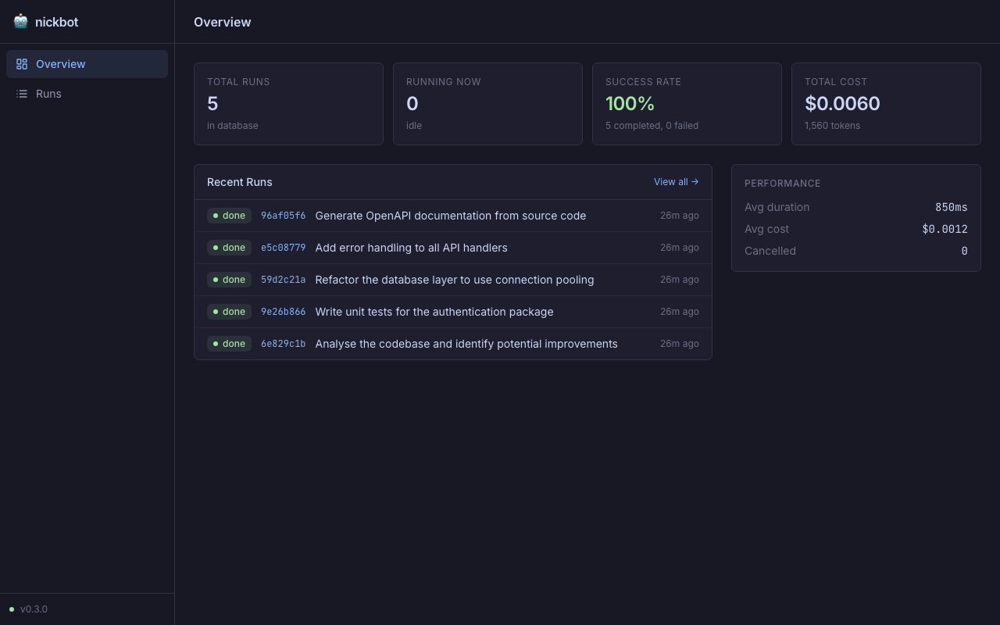

# nickbot 🤖

A Go-first platform for running, tracking, and composing AI agents. It gives every agent run a persistent record, a live terminal UI, and a machine-readable event stream — all from a single CLI.

---

## ✨ Features

- **🌐 Web dashboard** — browse run history, inspect events, and watch live output in the browser ([docs](docs/web-dashboard.md))
- **📺 Live TUI** — watch agent events stream in real time with a polished terminal UI
- **💾 Persistent history** — every run is stored in a local SQLite database with full event logs
- **⏱️ Timeouts & cancellation** — set a deadline or cancel any live run by ID
- **✅ Post-run verification** — validate output by running a shell command after completion
- **🌿 Worktree isolation** — fork a git worktree so the agent works in a sandbox
- **🔌 MCP server** — expose agent operations as [Model Context Protocol](https://modelcontextprotocol.io) tools for Claude Desktop, Cursor, and others
- **📡 JSONL streaming** — pipe machine-readable events to `jq` or any other tool
- **🧪 Fake runner** — test orchestration logic without credentials or network access

---

## 🚀 Quick Start

### Build

```bash
go build -o agentctl ./cmd/agentctl/
```

### Run your first agent task

```bash
# Dry run with the built-in fake runner (no credentials needed)
./agentctl run --runner fake "Analyze the codebase"

# Real run with Claude Code
./agentctl run "Write tests for the auth package"
```

The first time you run, nickbot creates `~/.nickbot/nickbot.db` automatically.

---

## 🌐 Web Dashboard



nickbot ships a built-in web dashboard for browsing run history, inspecting individual runs, and watching live agent output.

```bash
# Start the API server
agentctl web

# In a second terminal, start the frontend
cd web && npm run dev
# → open http://localhost:5173
```

→ **[Full dashboard documentation with screenshots](docs/web-dashboard.md)**

---

## 🖥️ CLI Reference

### `agentctl run` — execute a task

```bash
agentctl run [flags] <prompt>
```

| Flag | Default | Description |
|------|---------|-------------|
| `--runner` | `claude` | Runner to use: `claude` or `fake` |
| `--model` | _(runner default)_ | LLM model override (e.g. `claude-sonnet-4-6`) |
| `--agent` | _(runner name)_ | Logical agent identifier |
| `--workdir` | _(cwd)_ | Working directory for tool execution |
| `--permission-mode` | `acceptEdits` | `acceptEdits` · `bypassPermissions` · `default` · `dontAsk` |
| `--isolate` | `false` | Fork a git worktree for filesystem isolation |
| `--timeout` | `0` | Cancel after N seconds (0 = no limit) |
| `--verify` | _(none)_ | Shell command to run after successful completion |
| `--json` | `false` | Emit JSONL events instead of the TUI |

**Examples**

```bash
# Run with a 2-minute timeout
agentctl run --timeout 120 "Refactor the database layer"

# Verify the output compiles before accepting
agentctl run --verify "go build ./..." "Add error handling to handlers"

# Run tests after the agent finishes
agentctl run --verify "go test ./..." "Fix the failing tests"

# Isolated run in a git worktree
agentctl run --isolate "Try a risky refactor"

# Pipe events to jq
agentctl run --json "Summarise the repo" | jq .
```

---

### `agentctl runs` — list recent runs

```bash
agentctl runs [--limit N] [--json]
```

Shows a table of recent runs with ID, agent, status, timestamp, and cost.

---

### `agentctl status` — inspect a run

```bash
agentctl status <run-id>
```

Full detail view: prompt, result, cost, token counts, timestamps, and any error.

---

### `agentctl logs` — stream event log

```bash
agentctl logs <run-id> [--json]
```

Shows every event in the run in sequence — text, tool calls, tool results, completion.

---

### `agentctl inspect` — deep dive

```bash
agentctl inspect <run-id>
```

Like `logs` but shows full event payloads without truncation.

---

### `agentctl cancel` — stop a live run

```bash
agentctl cancel <run-id>
```

Sends `SIGTERM` to the runner subprocess and marks the run as `cancelled`.

---

### `agentctl web` — start the web dashboard

```bash
agentctl web [--port 7545] [--host localhost]
```

Starts a REST API server. Point a browser at the frontend to get the full dashboard UI — see **[docs/web-dashboard.md](docs/web-dashboard.md)** for screenshots and full API reference.

```bash
# Terminal 1: API server
agentctl web

# Terminal 2: frontend dev server
cd web && npm run dev
# → open http://localhost:5173
```

---

### `agentctl mcp` — start the MCP server

```bash
agentctl mcp
```

Runs a [Model Context Protocol](https://modelcontextprotocol.io) server over stdio. MCP-compatible hosts can then call `start_run`, `get_run`, `list_runs`, and `get_events` as tools, and browse runs as MCP resources.

**Claude Desktop integration**

Add this to your Claude Desktop config (`claude_desktop_config.json`):

```json
{
  "mcpServers": {
    "nickbot": {
      "command": "/path/to/agentctl",
      "args": ["mcp"]
    }
  }
}
```

---

## 🗂️ Project Structure

```
cmd/agentctl/          CLI binary (Cobra)
  cmd/run.go           agentctl run
  cmd/runs.go          agentctl runs
  cmd/status.go        agentctl status
  cmd/logs.go          agentctl logs
  cmd/cancel.go        agentctl cancel
  cmd/mcp.go           agentctl mcp
  cmd/web.go           agentctl web

internal/
  agent/               Core types: Event, Run, RunRequest, Runner interface
  runners/fake/        Deterministic fake runner for testing
  runners/claudecode/  Claude Code CLI adapter
  orchestration/       Run lifecycle: dispatch, persist, timeout, verify
  store/sqlite/        SQLite persistence (pure Go, no cgo)
  verifier/            Post-run shell command validation
  ui/                  Lipgloss styles, formatters, Bubble Tea TUI
  mcp/                 MCP JSON-RPC stdio server
  api/                 HTTP REST API (runs, events, SSE streaming)

web/                   React + TypeScript frontend (Vite + Tailwind)
  src/pages/           Overview, Runs list, Run detail
  src/components/      Shared UI, event log, event graph (React Flow)
  src/api/             Typed fetch client + SSE helper
  src/lib/             TanStack Query hooks, utilities
```

---

## 🏗️ How It Works

```
agentctl run "prompt"
      │
      ▼
 Orchestrator ──creates──▶ runs table (status: pending → running)
      │
      ├──dispatches──▶ Runner (fake | claudecode)
      │                    │
      │                    │ event stream
      │                    ▼
      ├──persists──▶ events table (started, text, tool_use, …, completed)
      │
      ├──(optional) verify ──▶ shell command ──▶ EventVerification
      │
      └──updates──▶ runs table (status: completed | failed | cancelled)
```

**Runners** emit a typed event stream over a Go channel:

| Event | Meaning |
|-------|---------|
| `started` | Runner subprocess is alive |
| `text` | Agent message chunk |
| `tool_use` | Agent invoked a tool |
| `tool_result` | Tool returned a result |
| `completed` | Run finished successfully |
| `failed` | Run ended with an error |
| `verification` | Post-run verify command result |

---

## 📋 Runbook

Common task patterns with copy-paste examples: test generation, safe refactoring, verified changes, batch scripting, and more.

→ **[docs/runbook.md](docs/runbook.md)**

---

## 🧪 Development

```bash
# Run all tests (with race detector)
go test -race ./...

# Build the binary
go build -o agentctl ./cmd/agentctl/

# Verbose run with a custom database
./agentctl --verbose --db /tmp/test.db run --runner fake "Hello"
```

> **Note:** The Claude Code runner guards against running inside an existing Claude Code session (`CLAUDECODE` env var). Unset it before testing the real runner:
> ```bash
> env -u CLAUDECODE ./agentctl run "Do something"
> ```

---

## ⚙️ Configuration

| Option | Default | Description |
|--------|---------|-------------|
| `--db` | `~/.nickbot/nickbot.db` | SQLite database path |
| `--json` | `false` | Machine-readable JSONL output |
| `--verbose` | `false` | Debug-level logging to stderr |

The database is created automatically on first use. Parent directories are created as needed.

---

## 📄 License

MIT
