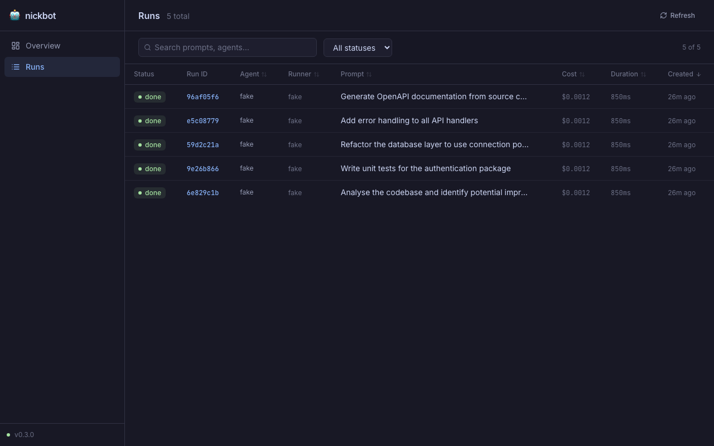
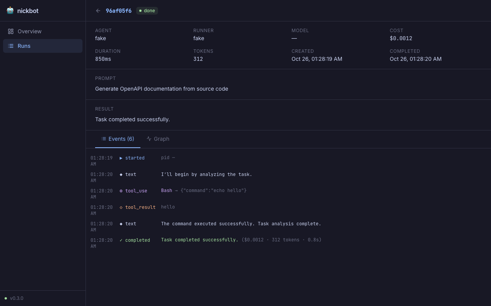
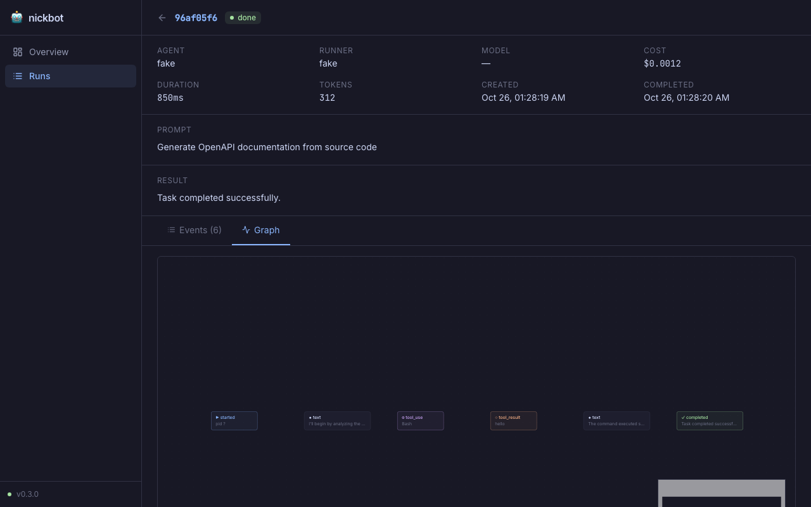

# Web Dashboard

nickbot ships a built-in web dashboard that lets you browse run history, inspect individual runs, and watch live agent output — all without leaving the browser.

---

## Starting the dashboard

**Step 1 — start the API server**

```bash
agentctl web
# or on a custom port:
agentctl web --port 8080
```

The server listens on `http://localhost:7545` by default and prints its address on startup.

**Step 2 — serve the frontend**

During development, run the Vite dev server from the `web/` directory:

```bash
cd web && npm run dev
# → http://localhost:5173
```

For a production build that you can serve from any static host:

```bash
cd web && npm run build
# output in web/dist/
```

> The Vite dev server automatically proxies `/api` requests to the Go API server, so both can run side by side without CORS issues.

---

## Views

### Overview


The **Overview** page gives you an at-a-glance summary of everything in the database:

| Card | What it shows |
|------|---------------|
| Total Runs | Count of all runs ever recorded |
| Running Now | Live count of active runs (auto-refreshes every 3 s) |
| Success Rate | Completed ÷ (completed + failed), as a percentage |
| Total Cost | Cumulative USD cost across all runs |

Below the stats you get a **Recent Runs** list linking directly to run detail pages, an **Active Runs** sidebar that appears only when something is live, a **Recent Failures** sidebar for quick triage, and a **Performance** card showing average duration and average cost per run.

---

### Runs list



The **Runs** page shows every run in a sortable, filterable table. Columns:

| Column | Notes |
|--------|-------|
| Status | Colour-coded badge: done · running · failed · cancelled |
| Run ID | First 8 characters of the UUID, links to detail |
| Agent | Logical agent identifier |
| Runner | Which runner executed the task (`claude`, `fake`, …) |
| Prompt | Truncated prompt text |
| Cost | USD cost (dimmed when zero) |
| Duration | Wall-clock time from start to completion |
| Created | Relative timestamp |

Use the **search box** to filter by prompt text or agent name, and the **status dropdown** to narrow by run state. Click any row to open the run's detail page.

---

### Run detail — event log



The **Run Detail** page opens at the **Events** tab, which shows every event emitted during the run in chronological order. The header strip gives you the full metadata:

- Agent · Runner · Model · Cost
- Duration · Token count · Created · Completed timestamps

Below that you see the original **Prompt** and the agent's **Result** (or **Error** for failed runs). If the run was spawned by a parent run, a breadcrumb link appears here too.

Each event row shows the timestamp, event kind (with a colour-coded icon), and a summary of the event's payload:

| Kind | What you see |
|------|-------------|
| `started` | Process PID |
| `text` | Agent message content (truncated) |
| `tool_use` | Tool name and input JSON |
| `tool_result` | Tool output (red if `is_error`) |
| `completed` | Result summary + cost + tokens + duration |
| `failed` | Error message |
| `verification` | ✓ / ✗ and the verify command |

When a run is **live**, the log auto-scrolls as new events arrive via Server-Sent Events and a pulsing dot shows the stream is active.

---

### Run detail — event graph



Switch to the **Graph** tab for an interactive DAG view of the same events. Each node represents one event; edges flow left-to-right in sequence. Dashed purple edges link `tool_result` nodes back to the `tool_use` that triggered them.

Node colours follow the event kind:

| Colour | Kind |
|--------|------|
| Blue border | `started` |
| Purple border | `tool_use` |
| Peach border | `tool_result` |
| Green border | `completed` |
| Red border | `failed` |
| Sky border | `verification` |

The graph is interactive: you can pan, zoom, and use the minimap in the bottom-right corner to navigate large runs with many events.

---

## API reference

The `agentctl web` command exposes a JSON REST API at `/api/v1/`. You can drive it directly from `curl`, scripts, or any HTTP client.

### Health

```
GET /api/v1/health
```

```json
{ "status": "ok", "version": "0.3.0" }
```

### List runs

```
GET /api/v1/runs?limit=50
```

Returns runs ordered by creation time descending.

### Get a run

```
GET /api/v1/runs/{id}
```

### Start a run

```
POST /api/v1/runs
Content-Type: application/json

{
  "prompt": "Refactor the database layer",
  "runner": "claude",
  "timeout_ms": 120000,
  "verify": "go build ./..."
}
```

Fields mirror the `agentctl run` flags. The response is `202 Accepted` with the initial run record.

| Field | Type | Default | Description |
|-------|------|---------|-------------|
| `prompt` | string | required | Task description |
| `runner` | string | `claude` | `claude` or `fake` |
| `agent_id` | string | runner name | Logical agent label |
| `model` | string | runner default | LLM model override |
| `workdir` | string | cwd | Working directory |
| `timeout_ms` | number | 0 | Cancel after N ms (0 = no limit) |
| `verify` | string | — | Shell command to run after completion |
| `isolate` | bool | false | Fork a git worktree for isolation |

### Cancel a run

```
POST /api/v1/runs/{id}/cancel
```

Sends SIGTERM to the runner subprocess and marks the run `cancelled`.

### List events

```
GET /api/v1/runs/{id}/events
```

Returns all persisted events for a run.

### Stream events (SSE)

```
GET /api/v1/runs/{id}/stream
Accept: text/event-stream
```

Opens a Server-Sent Events stream. Event types:

| SSE event | Payload |
|-----------|---------|
| `event` | `AgentEvent` — new event for the run |
| `run` | `Run` — updated run record (status change, etc.) |
| `done` | `{}` — run has reached a terminal state |
| `error` | `{ "error": "..." }` — stream error |

Existing events are replayed on connect, so a client that joins mid-run gets the full history followed by live updates.

---

## Architecture

The dashboard is strictly additive — it reads and writes through the same SQLite database as the CLI and MCP server. No schema changes are required; the `agentctl web` command just opens the existing `~/.nickbot/nickbot.db` (or whichever `--db` path you pass).

```
agentctl web
    │
    ├─ opens store (SQLite, same DB as CLI)
    │
    └─ starts HTTP server
           │
           ├─ GET  /api/v1/runs          → store.ListRuns()
           ├─ POST /api/v1/runs          → orchestration.Start()
           ├─ GET  /api/v1/runs/{id}     → store.GetRun()
           ├─ POST /api/v1/runs/{id}/cancel → SIGTERM + store.UpdateRun()
           ├─ GET  /api/v1/runs/{id}/events → store.ListEvents()
           └─ GET  /api/v1/runs/{id}/stream → SSE (polls store every 500 ms)
```

Live streaming uses 500 ms polling of the SQLite store rather than an in-memory pub/sub bus. This means any run started from the CLI, another MCP client, or the API itself is immediately visible in the dashboard without any coordination.
